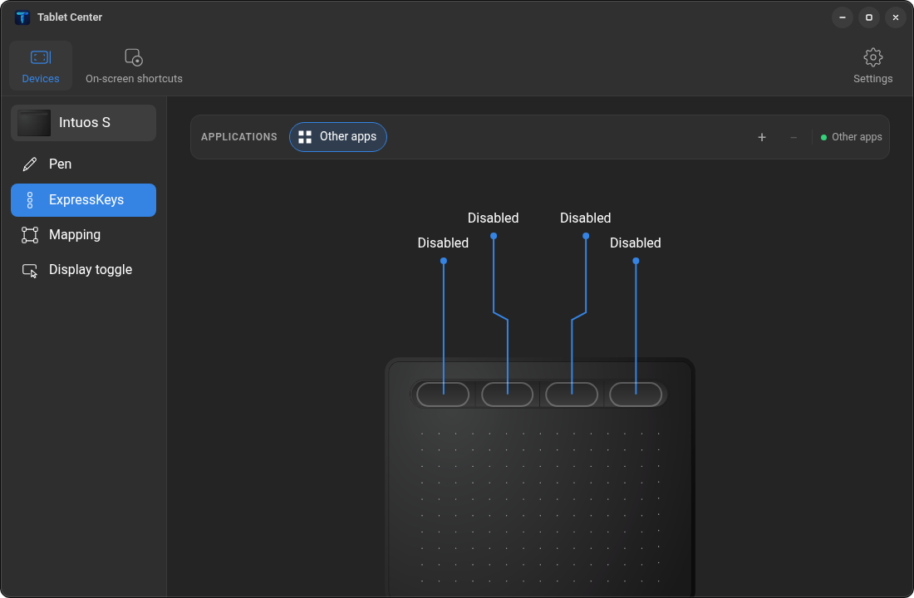
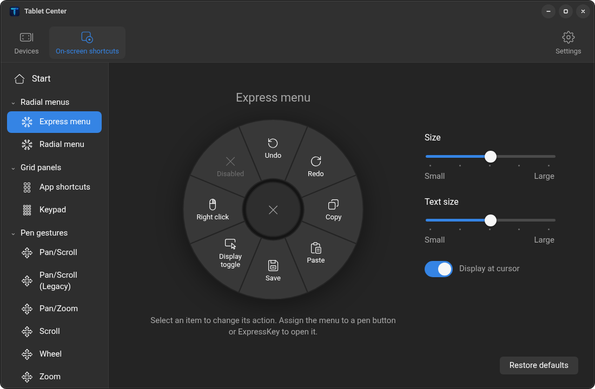
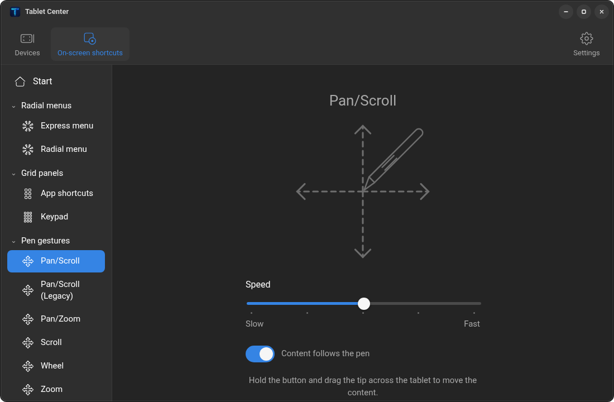
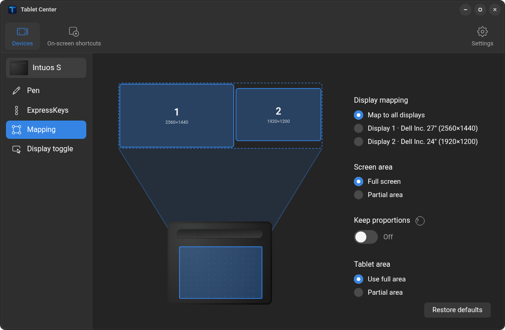
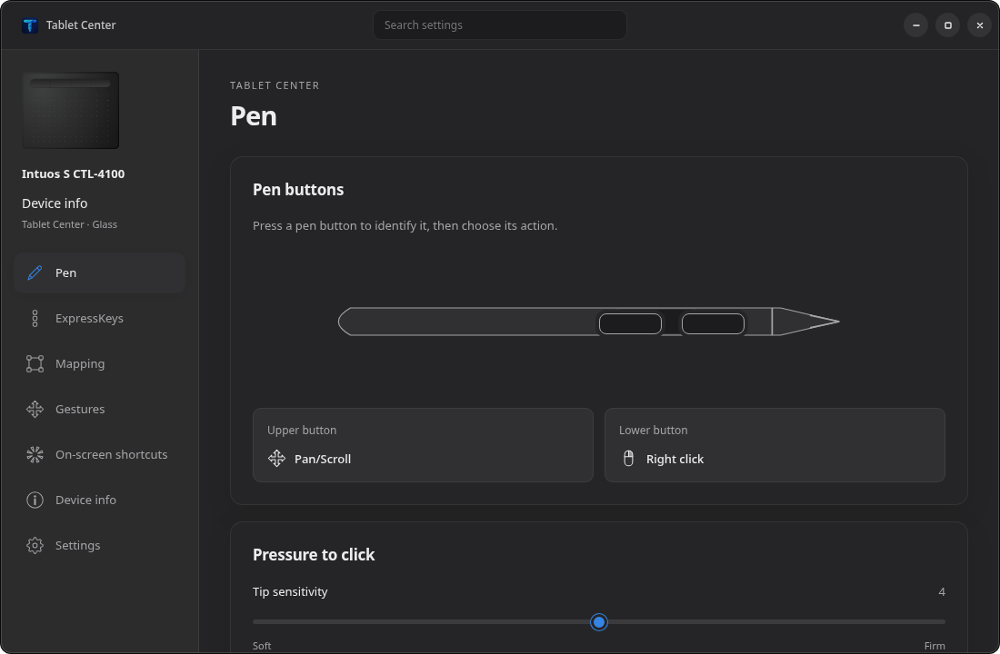

# Tablet Center

A settings app and a small daemon for Wacom pen tablets on GNOME (Wayland).
It adds the features the Linux driver lacks, starting with **pan scroll** as
it works on macOS.

> Unofficial project, not affiliated with or endorsed by Wacom. Wacom,
> Intuos and ExpressKeys are trademarks of Wacom Co., Ltd., used here only
> to say which hardware this works with.


## Install

You need GNOME on Wayland (version 48 or later) and an x86_64 PC. Keep the
pen **away from the tablet** while installing, then open a terminal and paste:

```sh
curl -fsSL https://github.com/wfpaisa/tablet/releases/latest/download/tablet-center-x86_64-linux.tar.gz | tar xz && ./tablet-center/install.sh
```

The installer may ask for your password once, to install WebKitGTK if it
is missing and to give your user access to the tablet. When it finishes,
**log out and back in**, then open **Tablet Center** from the app grid.
If the tablet does nothing after that, restart the computer.

Prefer to download by hand? Get `tablet-center-x86_64-linux.tar.gz` from the
[latest release](https://github.com/wfpaisa/tablet/releases/latest), extract it, and run `./install.sh`
inside the `tablet-center` folder.

**Uninstall:** run `./tablet-center/uninstall.sh` (add `--purge` to delete
your settings too).

## Screenshots

| | |
|---|---|
|  |  |
| ExpressKeys | Express menu, one of the on-screen shortcuts |
|  |  |
| Pan/Scroll, the macOS-style pen gesture | Mapping to all displays or one |
|  | |
| The alternative Glass interface, dark theme | |

## Features

- **Pan scroll**: hold the upper pen button and the cursor freezes; touch the
  tablet and drag to scroll in any direction. Lifting stops at once, with no
  momentum. Five speeds; content can follow the pen or move against it.
- **Pen gestures**: besides Pan/Scroll, the joystick-style Pan/Scroll
  (Legacy), Wheel and Zoom from the macOS driver (the farther you move the
  pen, the faster it goes), vertical-only Scroll, and Pan/Zoom (drag the tip
  to pan, move the pen in the air to zoom). Each has its own speed.
- **On-screen shortcuts**: Express menu and Radial menu (eight slices around
  the pen), App shortcuts (a grid of twelve) and a numeric Keypad, opened
  from a pen button or ExpressKey. Each entry runs a keystroke, click,
  Display toggle or another shortcut.
- **Pen buttons**: any pen gesture or on-screen shortcut, left/right/middle/
  double click, back, forward, Display toggle, or disabled.
- **Tip feel**: seven pressure curves, soft to firm.
- **Mapping**: drive all displays or a single monitor, with optional forced
  proportions. Follows monitor layout changes live.
- **ExpressKeys**: keystrokes (recorded or presets), mouse clicks, pen
  gestures, on-screen shortcuts, Display toggle.
- **Display toggle**: cycle the pen between all displays and each monitor.
- **Settings**: autostart, and backups of your settings to restore later.
- **Two interfaces**, switchable in Settings: *Tablet* (the macOS layout)
  and *Glass*, which draws its own slightly see-through window without the
  system title bar. Both show which pen button or ExpressKey is being
  pressed.
- **Right click, hold for middle**: one pen button gives a right click on a
  tap and a held middle button (to drag, e.g. Super+drag resizes) when held
  or moved. A small GNOME Shell extension, installed by `install.sh`, draws
  a ring next to the cursor while it waits.
- **On-screen shortcuts in GNOME Shell** (Settings): the same extension can
  draw the radial menus and grid panels, so they open at once without a
  window or focus change. Tablet Center's window remains the fallback.
- **Pen as a mouse**: optional single cursor that changes shape over text
  and borders, for when you don't need pressure.
- **14 languages**, English by default.

Tested with an Intuos S (CTL-4100). Other Wacom pens should work; the UI
artwork currently covers the Intuos S only.

## Details

The installer puts everything under your home folder: `tabletd` as a
systemd user service that starts with your session, the Tablet Center app
in the app grid, and its GNOME Shell extension. Only the system part needs
your password: WebKitGTK 4.1 when it is missing, a udev rule for
`/dev/uinput`, and membership in the `input` group. Check the service with
`systemctl --user status tabletd`.

GNOME is required because the daemon reads the monitor layout from Mutter;
other desktops are not supported (contributions welcome).

### From source

Install Rust (stable) and the
[Tauri 2 Linux prerequisites](https://v2.tauri.app/start/prerequisites/#linux),
then run `bun run install:local` (or `./install.sh`) from a checkout: it
builds the binaries first. The other scripts are listed under
[Development](#development).

Changes are applied immediately; there is no Save button.

On-screen shortcuts open as a transparent full-screen window on the monitor
under the pen, because Wayland does not let an app place its own windows.
Picking an entry closes it, and the action reaches the app you were using.

## How it works

```
tablet ──> tabletd ──> virtual pen, pointer and keyboard (uinput) ──> GNOME
              ^
              └── settings + live status (Unix socket) ── Tablet Center (Tauri)
```

- **`tabletd`** (`crates/tabletd`) takes exclusive control of the tablet,
  applies your settings and re-emits the result through virtual devices.
  Scrolling and clicks go through a separate absolute pointer, because GNOME
  gives a tablet tool its own cursor.
- **Tablet Center** (`crates/tablet-center`, `ui`) is a Tauri app with
  a plain HTML/CSS/JS front end. It writes
  `~/.config/tablet-center/config.json` and tells the daemon to reload over
  `$XDG_RUNTIME_DIR/tabletd.sock`.
- **`tablet-config`** (`crates/tablet-config`) holds the settings and the
  socket protocol shared by both.

## Development

The scripts in `package.json` run with [Bun](https://bun.sh) (`dev.sh` also
needs it for its local server); each one wraps a shell script you can run
directly.

```sh
bun run dev               # open the app; UI only, talks to the installed service
bun run dev:daemon        # same, plus a local tabletd build if the service is stopped
bun run test              # cargo test for the whole workspace
bun run install:local     # build and install the app, service and extension (./install.sh)
bun run uninstall:local   # remove them again (./uninstall.sh; add --purge to delete settings)
bun run package           # build the release archive in dist/ (scripts/package.sh)
bun run release 0.2.0     # publish version 0.2.0 (scripts/release.sh)
```

The window loads `ui/` from a local server, so UI edits show up with
Ctrl+R without rebuilding.

`release` checks that `main` is clean and tested, sets the version in
`Cargo.toml`, commits, tags `v0.2.0` and pushes. GitHub Actions then builds
the archive and publishes the release with notes generated from the commits.
`install:local` and `uninstall:local` are not called `install` and
`uninstall` because package managers run scripts with those names on their
own during `bun install`.

**Careful when changing `tabletd`.** gnome-shell (Mutter 51) crashes if a
virtual tablet disappears, or the tablet changes owner, while the pen is in
proximity, and that ends your session. The daemon avoids this by releasing
everything before removing its devices, grabbing the tablet only while the pen
is away, and never reusing the real pen's serial. Keep those guarantees when
you change it, and stop the daemon with SIGTERM, never SIGKILL.

## Credits

- Font: [Roboto](https://github.com/googlefonts/roboto-classic) via
  Fontsource (SIL Open Font License, `ui/assets/fonts/OFL.txt`).
- App icon: drawn for this project.

## License

GPL-3.0-or-later. See [LICENSE](LICENSE).
