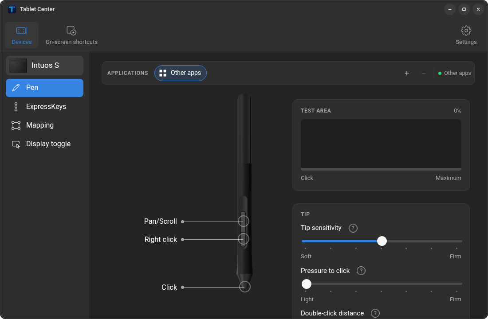
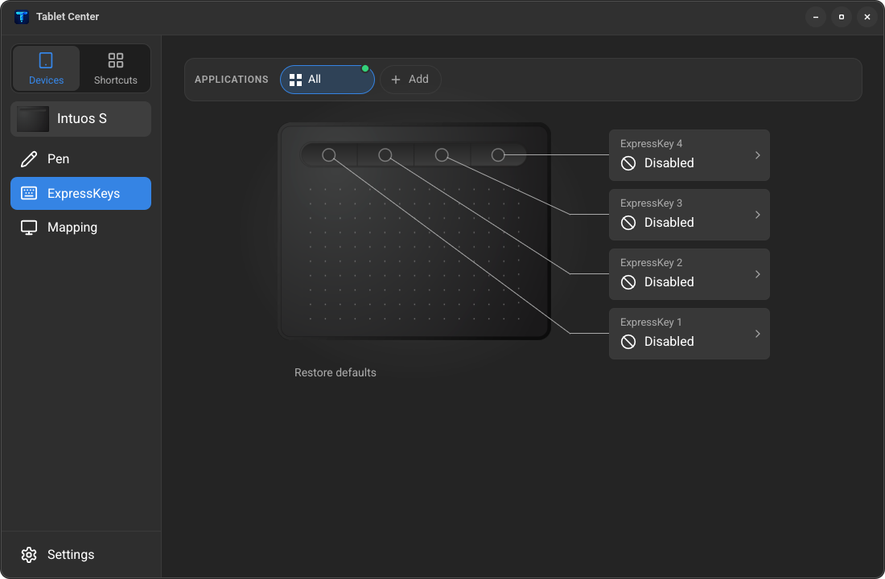
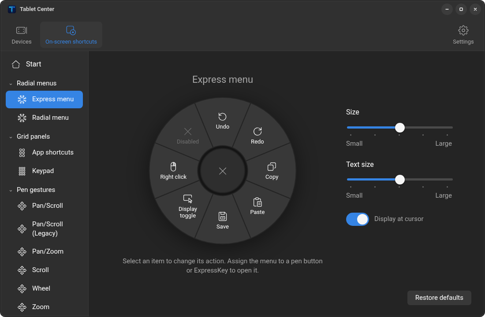
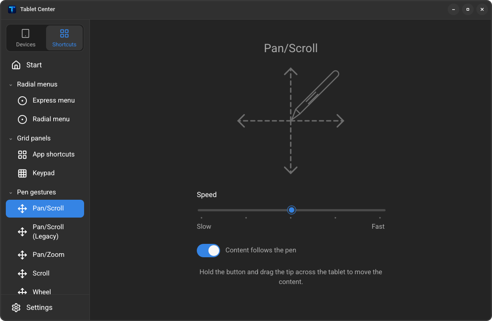
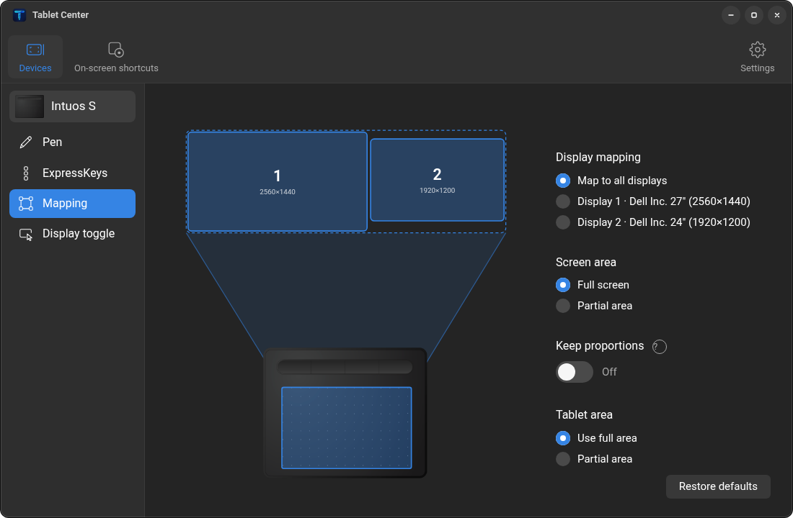

# Tablet Center: Wacom settings for Linux

Configure your Wacom tablet on GNOME Wayland. Adjust the pen, buttons and
screens, scroll with pen gestures, and open shortcut menus while you work.
Changes apply immediately.

Tested with the Intuos S (CTL-4100). Other Wacom tablets may work.
Built in Rust with egui.

> Unofficial project, not affiliated with or endorsed by Wacom. Wacom,
> Intuos and ExpressKeys are trademarks of Wacom Co., Ltd.



## Install

Requires GNOME 48 or later on Wayland and an x86_64 PC.
Keep the pen away from the tablet, then run:

```sh
curl -fsSL https://github.com/wfpaisa/tablet/releases/latest/download/tablet-center-x86_64-linux.tar.gz | tar xz && ./tablet-center/install.sh
```

Enter your password if asked. When installation finishes, log out and back
in, then open **Tablet Center** from the app grid. If the tablet still does
not respond, restart the computer.

For a manual download, get `tablet-center-x86_64-linux.tar.gz` from the
[latest release](https://github.com/wfpaisa/tablet/releases/latest), extract
it, and run `./install.sh` inside the `tablet-center` folder.

To uninstall, run `./tablet-center/uninstall.sh`. Add `--purge` to remove
your settings too.

## Features

- **Pen settings:** adjust pressure, click sensitivity and double-click
  distance. Choose pen or mouse mode.
- **Button actions:** assign keyboard shortcuts, clicks, gestures or menus
  to pen buttons and ExpressKeys.
- **Scrolling and zoom:** hold a pen button and move the pen to scroll,
  pan or zoom. Adjust the speed and direction.
- **Shortcut menus:** open a radial menu, a grid of app shortcuts or a
  numeric keypad from a tablet button.
- **Screen mapping:** use one screen or all screens, limit the active area,
  and keep the pen movement proportional to the screen.
- **App profiles:** use different settings for each application.
- **Right click, hold for middle:** tap for a right click; hold or move the
  pen for a middle click.
- **Settings:** choose from 14 languages, start the app at login, and back
  up or restore your configuration. English is the default language.

The included GNOME Shell extension can show shortcut menus over your current
application without switching focus. Enable this in **Settings**. Without
it, menus open in a separate window.

## Screenshots

| | |
|---|---|
|  |  |
| Tablet button actions | On-screen shortcut menu |
|  |  |
| Scroll with the pen | Choose the screens your tablet controls |

## Installation details

The installer adds the app, a background service (`tabletd`) and a GNOME
Shell extension to your home folder. The service starts with your session.
Your password is needed to set up tablet access: a udev rule for
`/dev/uinput` and membership in the `input` group.

To check the service:

```sh
systemctl --user status tabletd
```

GNOME is required because the service reads screen information from Mutter.
Other desktops are not supported.

### Build from source

Install stable [Rust](https://rustup.rs), clone this repository, then run:

```sh
./install.sh
```

This builds and installs the app, service and extension. No WebKitGTK is
required. Keep the pen away from the tablet during installation.

## How it works

`tabletd` reads the tablet input, applies your settings, and sends pen,
mouse and keyboard events to GNOME through virtual input devices.
Tablet Center is the settings app.

| Component | Purpose |
|---|---|
| `crates/tablet-center` | Settings window, built with egui and wgpu |
| `crates/tabletd` | Background service that handles tablet input |
| `crates/tablet-config` | Shared settings and communication format |

Settings are stored in `~/.config/tablet-center/config.json`. The app and
service communicate through `$XDG_RUNTIME_DIR/tabletd.sock`.

## Development

Install [`just`](https://github.com/casey/just) to run the project tasks.
Run `just` to list them, or see [docs/development.md](docs/development.md)
for the full workflow.

```sh
just dev          # open the app with the installed service
just dev-sim      # try simulated data without changing your settings
just check        # check formatting, code quality and tests
just screens      # generate screenshots (requires a GPU)
just compare      # compare screenshots with the visual references
just package      # create a release archive in dist/
```

Review screenshots at 1100×720 and 1100×1600 against `docs/reference/`.
Check text, layout, colors and icons visually as well as the reported image
differences.

**When changing `tabletd`:** Mutter can crash and end the session if a
virtual tablet is removed or changes owner while the pen is near the tablet.
Preserve the daemon's safeguards: release inputs before removing devices,
wait until the pen is away before taking control, and never reuse the real
pen's serial number. Stop the daemon with SIGTERM, not SIGKILL.

## Credits

- Fonts: [Roboto](https://github.com/googlefonts/roboto-classic), SIL Open
  Font License.
- App icon: created for this project.

## License

GPL-3.0-or-later. See [LICENSE](LICENSE).
